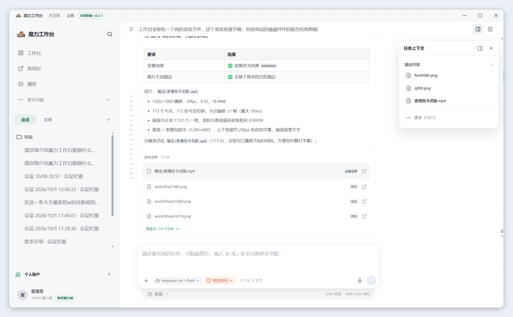

<h1 align="center">
   魔力工作台
</h1>

<p align="center">
  <strong>一个能读文件、做内容、处理办公任务并操作工具的本地 Agent 工作台。</strong><br/>
  选好工作目录，用自然语言说明目标，剩下的交给 Agent 执行和检查。
</p>

<p align="center">
  
  
  
</p>

<p align="center">
  简体中文 · <a href="README.en.md">English</a> · <a href="https://github.com/ponysb/mlimli/issues">问题反馈</a> · <a href="docs/TERMINAL.md">终端版</a>
</p>

<p align="center">
  
</p>

<p align="center">
  <strong>代码工作台（编辑 · Git · LSP）</strong> · <strong>TUI / CLI</strong> · <strong>多 Agent 编排</strong> · <strong>ACP 客户端接入</strong><br/>
  <strong>个人助理</strong> · <strong>飞书 / 钉钉</strong> · 文档办公 · 内容创作 · 网页与应用操作
</p>

## 它能做什么

| 场景 | 你可以直接这样说 |
| --- | --- |
| 资料整理 | “整理这个文件夹，按主题归类，并生成一份带链接的目录。” |
| 文档办公 | “读取这些材料，整理成一份 Word 报告，并检查标题和表格格式。” |
| 表格数据 | “分析这份销售表，找出异常数据，补充公式并生成图表。” |
| 演示文稿 | “把这份方案做成 10 页汇报 PPT，保留数据来源。” |
| 写作创作 | “根据人物设定续写第三章，保持现有语气，并检查前后矛盾。” |
| 图片与视频 | “按这份脚本整理分镜、素材清单和生成提示词，再输出成片方案。” |
| 网页与应用 | “登录我已授权的应用，汇总今天的待办，并把结果写入项目文件。” |
| 代码与网站 | “运行这个项目，修复首页在手机上的布局问题，用 LSP 检查诊断和引用，再验证主要交互。” |
| 多 Agent 编排 | “并行检查登录、错误处理和测试缺口，主任务汇总证据并给出修复方案。” |
| 个人助理 | “每天早上汇总我的日程和项目进展，整理成简报；有新消息时提醒我。” |

任务不只停在回答里。获得授权后，Agent 可以读取和修改工作目录、执行命令、调用 Skill 与插件，并把产物直接放回项目中。

## 开始使用

### 1. 安装并打开

在 [Releases](https://github.com/ponysb/mlimli/releases) 中选择与你系统匹配的版本。Windows 与 macOS 安装包包含桌面端和 `mli` 命令；Linux 提供 TUI / CLI 压缩包。已安装版本可在 **设置 → 应用更新** 检查更新。

如果 Releases 暂无可用安装包，可使用下方的[源码运行](#源码运行)。

### 2. 配置模型

打开 **设置 → 模型配置 → 添加模型**，填写：

- 协议：OpenAI Chat Completions、OpenAI Responses 或 Anthropic Messages
- API 地址、API Key 和模型名称
- 可选的上下文窗口等参数

你可以配置多个服务商和模型，之后在输入框下方随时切换。API 费用和数据处理规则由你选择的服务商决定。

### 3. 添加工作目录

点击工作台中的 **添加工作目录**，选择本次任务使用的文件夹。会话、项目记忆和任务产物都围绕这个目录组织，不同项目互不混用。

### 4. 描述任务

在输入框说明目标、已有材料、输出格式和验收标准，然后发送。写得越具体，结果越稳定，例如：

> 阅读 `资料/` 下的文件，整理一份项目周报。输出 `本周周报.docx`，包含进展、风险、下周计划和负责人；缺失信息单独列出，不要猜测。完成后重新打开文件检查排版。

默认的 **人工审批** 模式会在写文件、执行命令或进行敏感操作前询问你。需要连续执行时可切换权限模式，但建议先确认工作目录和任务范围。

## 常用操作

- **添加材料**：点击输入框左侧的 `+`，引用文件、文件夹、Skill 或插件；图片也可以直接拖入。
- **查看结果**：在左侧切换“会话 / 文件”，预览 Agent 生成或修改的文件；工具过程可展开查看。
- **继续修改**：直接在当前会话补充要求，例如“第二部分压缩到 300 字，表格不要改”。
- **并行处理**：点击 **派发子任务**，让不同子 Agent 分别检索、制作或检查，主任务会汇总结果。
- **多 Agent 编排**：主 Agent 可以按角色派发 explorer、researcher、reviewer 和 worker，异步并行执行、等待结果、追加指令或整组停止；每个子任务拥有独立上下文，结果回到主任务统一汇总。
- **定时执行**：打开 **定时任务**，设置任务内容、运行时间和工作目录；每次运行都会生成独立会话。
- **个人助理**：结合项目记忆、历史会话、定时任务和消息渠道，让 Agent 持续记住你的偏好、跟进事项并按时提醒。
- **使用专家与 Skill**：在 **专家库** 选择适合的工作方式，Agent 会按任务需要读取 Skill，而不是把全部内容塞进上下文。
- **操作已登录网站**：在 **应用台** 添加网站，亲自登录并确认授权，再让 Agent 读取或操作页面。
- **连接飞书与钉钉**：在 **设置 → 连接渠道** 配置机器人凭据、工作区和群聊 / 用户白名单；可以在消息中发起任务、接收结果，并要求群聊必须 @机器人。
- **语音与会议**：长按输入框旁的麦克风进行语音输入；单击可录制会议、实时转写并生成纪要。
- **记住偏好**：在 **设置 → 记忆** 查看、编辑或停用已保存的偏好和项目经验。
- **终端使用**：运行 `mli` 打开 TUI，或用 `mli exec "任务"` 执行一次性任务。完整命令见 [终端版说明](docs/TERMINAL.md)。

## 主要功能

<table>
<tr>
<td width="50%" valign="top">

### 代码工作流：编辑、LSP、终端

代码编辑、内置终端、Git、LSP 诊断和代码导航放在同一个工作区。当前内置 TypeScript / JavaScript 与 Python 语言服务，支持定义、引用、悬停、实现、符号和调用层级查询；需要时可在本机安装语言服务器。

</td>
<td width="50%" valign="top">

### 自己选择模型

支持三种常见模型协议、自定义 API 地址和自有 API Key。多个模型可以按任务切换，不绑定单一服务商。

</td>
</tr>
<tr>
<td width="50%" valign="top">

### 任务会继续记住上下文

会话保存在本地；项目记忆只用于当前工作目录，全局偏好可跨项目使用。记忆支持审核、编辑、停用和版本恢复。

</td>
<td width="50%" valign="top">

### 多 Agent 编排

主 Agent 根据任务拆分独立分支，子 Agent 使用独立上下文并行检索、编写和审查。你可以在面板查看状态、用量和结果，追加指令或停止任务，最后由主任务统一汇总。

</td>
</tr>
<tr>
<td width="50%" valign="top">

### 网站登录留在本机

应用台使用隔离的内置浏览器保存登录状态。密码、验证码和 Cookie 不交给模型；Agent 只能在你确认授权后操作页面。

</td>
<td width="50%" valign="top">

### 个人助理与消息渠道

记忆、定时任务、语音会议和消息渠道组合成个人助理：在工作台里持续跟进项目，也可以通过飞书或钉钉接收提醒、发送任务和查看结果。

</td>
</tr>
</table>

### 终端、ACP 与外部客户端

除了桌面工作台，还可以使用 `mli` TUI / CLI 在终端完成同一套任务，支持会话恢复、命令面板、权限审批和 JSON 输出。运行 `mli acp` 后，外部 ACP 客户端可以创建会话、发送提示、接收工具调用和处理审批；MLI 也能把任务委派给已配置的外部 ACP Agent。


## 权限与数据

- 文件、会话、记忆和应用登录默认保存在本机。
- 任务需要的上下文会发送给你配置的模型或工具服务，请以相应服务的数据政策为准。
- 人工审批模式下，只读操作可直接进行；文件写入、命令和敏感操作会请求确认。
- Agent 命令使用工作区沙箱；沙箱不可用时会阻止命令执行。Windows 首次使用需在设置中安装原生沙箱。
- 应用台不会向模型提供密码、验证码、Cookie 或浏览器存储；发布、删除、购买等操作仍需明确授权。
- 第三方插件和 MCP 服务属于额外能力，安装前应确认来源和权限。

详细边界见 [运行沙箱](docs/SANDBOX.md)、[应用台](docs/APP-CENTER.md) 和 [交付质量与验收](docs/CLIENT-QUALITY.md)。

## 更多指南

- [终端版与 CLI](docs/TERMINAL.md)
- [LSP 语言服务](docs/LSP.md)
- [语音输入与会议](docs/VOICE-MEETINGS.md)
- [记忆](docs/MEMORY.md)
- [子 Agent](docs/SUBAGENTS.md)
- [ACP 接入](docs/ACP.md)
- [插件兼容说明](PLUGIN-COMPATIBILITY.md)

## 源码运行

源码运行需要 **Node.js 22.12 或更高版本** 与 npm：

```sh
git clone https://github.com/ponysb/mlimli.git
cd mlimli
npm ci
cp config.example.json config.json
npm run build:web
npm run electron
```

Windows PowerShell 可用 `Copy-Item config.example.json config.json` 代替 `cp`。浏览器模式运行 `npm start` 后访问 `http://127.0.0.1:3000`。构建安装包和参与贡献的说明见 [Windows 打包](docs/WINDOWS-PACKAGING.md)、[终端版说明](docs/TERMINAL.md) 与仓库中的开发文档。

## 交流与支持

<p>
  <a href="https://space.bilibili.com/7318180"></a>
  <a href="https://xhslink.cn/o/7exC6HysEHH"></a>
  <a href="electron/assets/dyh.png"></a>
  <a href="electron/assets/qq.png"></a>
</p>

遇到问题或有功能建议，请提交 [Issue](https://github.com/ponysb/mlimli/issues)。

## 许可证

魔力工作台基于 [Apache-2.0](LICENSE) 许可证开源。内置第三方 Skill、插件与素材保留各自的许可证及通知。
