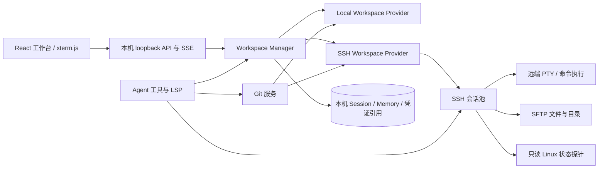

# SSH 远程工作区与 Git 集成评估

评估日期：2026-10-28。依据当前工作台、Agent Runtime、终端、文件 API、沙箱和云平台设计。P0–P3 已有基础实现；P5 当前已有本机和 SSH Git 基础工作流，clone 创建流程及真实托管服务/跨平台验收仍未完成；远程 LSP 仍未实现。状态以本地代码及末尾列出的测试证据为准。

## 结论

建议把“SSH 服务器”和“Git 托管平台”作为两个可组合的工作区连接维度：工作区可以是本地目录或 SSH 主机上的目录；该目录可以是 Git 仓库，remote URL 可指向 GitHub、GitLab、Gitee、自建实例或任意兼容 Git 的地址。

推荐做成客户端直连 SSH 的远程工作区。交互终端走 SSH PTY，目录和文件走 SFTP，Agent 的命令在远端执行，Agent 文件工具走统一的 Workspace Provider。连接、主机指纹和本地会话元数据由客户端管理，不经过 MLI SaaS 控制面。服务器性能先通过只读、固定脚本按需轮询，不要求安装常驻 Agent。

Git 的第一阶段应提供通用 Git 工作流和自定义 remote URL，而不是分别集成三家代码托管 API。GitHub/GitLab/Gitee 只是连接表单中的预设和帮助信息；基础 clone/status/diff/branch/commit/push/pull 都通过 Git 完成。PR/MR、Issue、OAuth 应用等平台专属功能另行立项。

需求已确认采用“远程原生工作区”：Agent 文件操作、终端命令和首发支持的 LSP 均在 SSH 目标服务器侧围绕同一远程目录执行。完整交付属于大改造，不是给现有终端加一个 `ssh` 命令即可完成。按一名工程师估算，含 SSH、远程浏览/性能、Agent 远程文件和命令、远程 LSP、基础 Git 交付约 13–21 人周；若先只交付 SSH 终端、目录浏览和性能面板，约 3–5 人周。Office/媒体工具和全量插件兼容另加约 2–4 人周，且需要按工具逐项验收。

这里的“远程原生工作区”指：用户在 MLI 中打开服务器已有的项目目录，代码不复制到本机；文件读写、命令、Git 和支持的 LSP 直接作用于服务器上的同一份目录。MLI 界面与项目会话在本机，项目文件和开发环境在服务器，使用体验类似 VS Code Remote SSH。它不同于“本机工作副本 + 上传/下载同步”，因此不会维护两份需要合并的代码；代价是 Agent 的远程命令使用服务器账号权限，断网时也不能继续操作远端项目。

## 当前实现与影响面

### 当前里程碑状态（2026-10-28）

| 里程碑 | 状态 | 本地证据/边界 |
| --- | --- | --- |
| P0 SSH 库、凭据和 host key 设计 | 已完成 | 使用 `ssh2@1.17.0`；连接信息存于用户数据私有目录；不保存私钥内容或口令 |
| P1 SSH 连接管理与远程交互终端 | 已实现并通过本机真实 SSHD | 首次指纹确认、固定指纹变化阻断、私钥登录、PTY 输入/尺寸/停止/断线清理和 loopback HTTP 防护；用例见 `test/ssh-connection-store.test.mjs`、`test/ssh-terminal-http.test.mjs` |
| P2 SFTP 目录与只读服务器状态 | 已实现基础范围；本地 SSHD 核心集成通过 | 文件目录/文本读写/常用变更、只读 Linux 指标；敏感路径、符号链接和递归删除预检有保护；无二进制预览/下载 |
| P3 Agent 远端文件与命令 | 已实现基础范围；本地 SSHD 集成通过 | Session 独立保存在本机；read/write/edit/grep/find/bash 路由远端；unsupported tool 明确拒绝；远端 shell 不受本机沙箱约束 |
| P4 远程 LSP | 未实现 | TS/JS、Python 语言服务仍未通过 SSH stdio 在服务器启动 |
| P5 通用 Git UI/远端操作 | 基础工作流已实现 | 本机与远端均支持变更/status、有限文本 diff、stage/unstage、staged commit、branch create/switch、fetch/fast-forward pull/push 和 remote URL；托管服务验收待做 |
| P6 三平台安装包和目标主机验收 | 部分完成 | macOS 本机 OpenSSH 集成可运行；已有 Windows staging 证据，尚未验证 Windows/Linux 实际客户端安装包、公网/跳板环境 |

此前完整套件记录为 601 tests，586 passed、15 skipped、0 failed；本轮未重跑完整套件。本轮 `npm run check` 通过（语法检查 492 文件），`npm run build:web` 通过（有 Vite 大 chunk 提示）；SSH/终端/工作区/Git 聚焦测试 17 passed、0 failed，包含真实临时 SSHD、中文与空格远端目录的 PTY `pwd`、loopback HTTP 防护、本地 Git API、各托管商/自托管 remote、安全校验和通用工作区回归。以上不证明 Windows/Linux 打包、公网/跳板连接或远程 LSP 已验收。

| 能力 | 当前实现 | 接入影响 |
| --- | --- | --- |
| 交互终端 | React `TerminalWorkspace` 使用 xterm.js；SSH PTY 支持输入、resize、停止、SSE 输出 | 已复用现有终端 UI；切换 backend 会停止当前 pane 并重建 |
| 工作区 | `core/workspaces.mjs` 记录 `kind: ssh`、连接 ID、远端根路径及独立本机 storagePath | 本机 Session 路径与远端代码目录分离；切换前检查连接和登记路径仍一致 |
| 文件操作 | `core/workspace-files.mjs` 按 active provider 路由到本机 fs 或 SSH SFTP | 已支持目录列举、有限文本读写、创建/改名/移动/删除预检；二进制、Office、媒体和复制不支持 |
| Agent 文件工具 | `read_file`、`write_file`、`edit_file`、`grep`、`find` 通过远端 Provider；未支持工具拒绝回退本机 | 已接入基础工具和权限框架；远程附件、全量工具兼容仍待做 |
| Agent 命令 | `bash` 使用 SSH `exec` 在工作区根目录运行 | 已接入；以 SSH 用户权限运行且不受本机沙箱限制，结果未知时不自动重放 |
| 会话和项目数据 | `core/workspaces.mjs` 为每个远程工作区创建本机 storagePath | Session/Memory 数据不进入远端项目；离线期间无法访问远端源码 |
| LSP | 语言服务器在拥有工作区的本机 Runtime 启动 | 远程文件 URI 和进程也必须在远端；首发可声明不支持，后续经 SSH stdio 桥接 |
| Git | 本机与 SSH Provider 共享结构化操作参数；面板支持变更、有限文本 diff、stage/unstage、只提交 staged 项、分支 create/switch、fetch、fast-forward pull、push 和 remote 管理 | `.git`/凭据路径拒绝暂存；存在受保护 staged 项拒绝提交；切分支/Pull 要求干净工作区；URL 不允许内嵌凭据；clone 流程、供应商 API 和真实公网 Git 鉴权尚未验收，Agent SSH shell 仍以服务器用户权限执行 |

关键现有接入点包括 `core/workspaces.mjs`、`core/paths.mjs`、`core/workspace-files.mjs`、`core/tools.mjs`、`core/run-context.mjs`、`core/lsp.mjs`、`server.mjs`、`react/src/TerminalWorkspace.jsx` 和 `react/src/main.jsx`。这些边界显示工作区路径目前不仅用于展示，还同时驱动安全策略、文件工具、Session、Memory、附件、子 Agent、沙箱及语言服务。

## 目标架构

### 连接与认证

- SSH 首版面向 Linux 主机，使用 SSH key；优先调用本机 SSH agent。可选私钥文件需由系统文件选择器选取，私钥不放进工作区、不进入 Session、不写普通配置文件。私钥口令只在内存短暂使用，除非建立经过平台加密的凭据存储。
- 首次连接必须展示并确认 host key 指纹；保存后严格校验 known-hosts。指纹改变时阻断连接并要求用户重新核验，不自动接受。
- 默认关闭 agent forwarding、端口转发和 X11 forwarding。断线要终止或明确标记相关 PTY/文件请求，重连不得静默重放写操作。
- 连接配置仅保存名称、host、port、user、认证方式和 secret reference。不要记录认证内容、完整私钥、含口令的 Git URL 或未脱敏命令输出。
- 远程连接由用户设备发起，SaaS API 不保存 SSH 私钥，也不代表 SaaS 服务端能访问用户内网主机。

### 工作区 Provider

定义覆盖本地和 SSH 的最小接口：`list`、`stat`、`read`、`write`、`mkdir`、`rename`、`move`、`copy`、`delete`、`realpath`、`search`、`exec` 和远程进程/stdio 通道。Agent 工具、文件面板、LSP 和 Git 操作依赖这个接口，不直接判断本地/远端。远端路径始终是相对工作区根的 POSIX 路径；初期不允许通过符号链接访问工作区外路径。写文件先写同目录临时文件，再 rename 替换，减少中断导致的半文件。

本机为每个 SSH 工作区保存独立会话存储目录；当前实现将 Session 和 Memory 保存在其中，Agent 附件读取仍未适配远端文件。远程工作区的支持文件读写由 SFTP 完成；项目命令通过 SSH `exec`，交互终端通过 SSH PTY。写工具沿用现有权限流程，但界面是否充分展示主机、路径和差异仍需 UI 验收。远程 shell 使用登录账号当前权限，MLI 的本机 Bubblewrap/Seatbelt/Docker 沙箱不会限制远端命令；高安全部署可在专用受限账号或容器中使用。

首发目标兼容矩阵为远程文件浏览/文本读写、附件读取、基础 Agent 文件工具、SSH 交互终端、远程 `bash`，以及内置 TS/JS 和 Python 语言服务。当前仅前述基础终端、SFTP 文本和部分 Agent 工具已有实现；附件与 LSP 尚未实现。LSP 后续计划通过 SSH stdio 在服务器启动，并要求远端安装授权、URI 映射和进程回收。Office 转换、FFmpeg、媒体工具、第三方语言包和假设本机绝对路径的插件仍需逐项适配或标记不支持。不要因目录可见就声称所有 Agent 工具可远程运行。

### 服务器状态与目录体验

- 连接详情页展示主机基本信息、CPU 利用率、内存总量/可用量、负载、工作区所在盘容量，以及有限数量的高占用进程。
- Linux 探针仅运行固定、无副作用的命令，输出结构化字段；不拼接用户输入。CPU 利用率由两次采样的 `/proc/stat` 增量计算。探针在页面打开时每 5 秒轮询，关闭页面即停止；接口超时、权限不足或系统不支持时显示采样时间和降级原因。
- 文件目录通过 SFTP 分页或逐层读取，显示名称、类型、大小、修改时间；按现有工作区路径规则隐藏 `.agent`、`.ssh`、密钥、`.env` 等受保护文件。大文件流式读取并限制上限。
- Agent 可以获取只读的主机概况和状态快照，帮助解释磁盘不足、内存压力或服务进程异常；默认不提供不受约束的 root、sudo 或任意管理命令。

## Git 集成方案

### 基础范围

每个工作区可绑定一个 Git 仓库：从 URL 克隆到所选本地/远程目录，或识别已有仓库。URL 支持 HTTPS 和 SSH 形式；预设 GitHub、GitLab、Gitee 与“自定义主机”，自定义项允许任意兼容 Git 的域名和端口。

基础 Git 面板包括当前分支、工作树状态、变更文件、diff、分支切换/创建、提交、fetch、pull、push 和 remote URL 管理。所有写入 `.git` 的动作由单独 Git 服务处理，使用参数数组/结构化参数及路径和 ref 校验，并按操作触发审批；Git URL 不允许内嵌密码/token。自建 GitLab、Gitee 企业版等不要求专用后端 API 即可使用 Git 基础功能。

远程 SSH 工作区中，Git 在目标服务器运行，复用服务器自己的 Git 安装、SSH agent 和 credential helper；MLI 不把本机 Git 私钥转发给目标服务器。HTTPS token/OAuth credential helper 由执行 Git 的那一侧管理。Git 输出中的认证 URL、token 和敏感配置必须脱敏。

### 不包含在首发

GitHub/GitLab/Gitee 专属 PR/MR、Issue、CI 状态、Webhook、组织仓库浏览、OAuth 应用授权和 SaaS 级凭据同步不属于“自定义 Git 地址”。这些能力分别依赖供应商 OAuth、API、权限范围和回调配置，应以 provider adapter 另立范围；自建 GitLab/Gitea 等还要配置自定义 API base URL。

## 关键设计决定与取舍

| 决定 | 建议 | 理由与代价 |
| --- | --- | --- |
| SSH 终端和远端工作区 | 同一连接模型，分阶段交付 | UI/认证复用；但完整文件/Agent 语义涉及多个本机路径假设 |
| 远端文件访问 | SFTP Provider | 不要求用户安装 MLI 服务端程序；需处理断线、路径、流式 I/O 和文件冲突 |
| Agent 命令位置 | 远端 `exec` / PTY | 保持“代码在目标机运行”；远端执行权限不受本机沙箱控制，必须明确授权和风险 |
| 会话数据 | 保存在本机 | 避免写入远端保留目录、暴露会话/模型数据或污染项目 Git 状态 |
| 语言服务 | SSH stdio 在服务器运行；首发覆盖内置 TS/JS 与 Python | 符合远程原生目录语义；需支持远端安装/发现、文件 URI 和进程回收 |
| 性能采集 | 无守护进程的按需只读探针 | 运维成本低；不同 Linux 发行版和权限可能造成数据不可用 |
| Git 托管服务 | 先支持通用 Git URL，不做三套 OAuth/API | 自建地址与企业实例自然可用；PR/MR 等需独立后续适配 |
| Agent Git 写操作 | 独立 Git 服务和逐项审批 | 现有沙箱默认保护 `.git` 为只读；放开任意 shell 写入会破坏当前安全边界 |

### SSH 技术路线

| 路线 | 优点 | 主要代价 | 结论 |
| --- | --- | --- | --- |
| 系统 OpenSSH 子进程 + SFTP 子进程 | 复用用户已配置的 SSH agent、known_hosts、ProxyJump 和系统密码学实现；与用户终端习惯一致 | 跨平台参数/agent socket 差异明显；PTY 流与结构化 SFTP 要分别桥接；依赖外部 `ssh`/`sftp` 安装和版本 | 可作为高级连接兼容路径或调试 fallback，不作为 Provider 的唯一实现 |
| Node SSH2 客户端库 + SFTP | 在 Electron/Node 内统一连接生命周期、host key 校验、PTY、SFTP 和取消；发布时可随应用打包 | 需自行做好 host key/agent 适配、算法兼容、channel 限额、维护和供应链审查；与系统 OpenSSH 配置不会天然完全一致 | 已实现并使用锁定的 `ssh2@1.17.0`；仍需跨平台及真实主机验收 |
| SSHFS 挂载成本地目录 | 对既有 `fs`、LSP 和部分插件的兼容性高，能复用本机工作区路径 | 需要 FUSE/WinFsp、安装权限、挂载生命周期与本地缓存一致性；断线和缓存会产生过期读写；本机沙箱/路径策略看到的是挂载点而非远端真实权限 | 不作为首发架构；可作为高级可选模式单独验证 |

`ssh2@1.17.0` 已锁定，Electron 依赖和许可证清单已更新；本机临时 OpenSSH 集成通过私钥、host key pin/换钥、PTY、SFTP 与断开清理的覆盖。SSH Agent 在跨平台目标、RSA/硬件 key、Jump host 和 ProxyCommand 尚未验收。若 Node SSH2 无法满足明确目标环境算法或系统 agent 要求，可评估系统 OpenSSH connector，同时维持一致的 Workspace Provider 契约。

## 分阶段与工作量

| 阶段 | 范围 | 粗估 |
| --- | --- | --- |
| P0：协议与威胁建模 | Provider 接口、SSH 库/许可审查、密钥策略、支持矩阵、交互原型 | 3–5 人日 |
| P1：SSH 连接与终端 | 主机配置/host key、SSH agent/key、连接状态、PTY、输入/输出/resize/停止/重连错误 | 1–2 人周 |
| P2：SFTP 与状态面板 | 远端目录/受保护路径、文本预览/读写、性能卡片、采样节流和断线状态 | 2–3 人周 |
| P3：Agent 原生远端工作区 | Workspace Provider、Agent 文件工具、远端 bash、权限审批、Session 本机存储、附件/搜索兼容 | 4–6 人周 |
| P4：远程 LSP | SSH stdio 通道、远端 server 探测/授权安装、TS/JS 与 Python 诊断/跳转、断线与诊断失效处理 | 2–4 人周 |
| P5：通用 Git | clone/绑定、status/diff、branch、commit、fetch/pull/push、本地/远端凭据边界和 UI | 2–3 人周 |
| P6：发布加固 | Windows/macOS/Linux 打包，真实 SSHD 回归、并发/断线/升级、文档和兼容验收 | 1–2 人周 |
| 可选：额外工具兼容 | Office/媒体工具、第三方语言包、带本机绝对路径假设的插件 | 2–4 人周起 |

阶段估算不可简单相加为日历工期。P0/P1、P2/P3 基础范围及 P5 基础 Git 操作已有代码；仍需完成 P3 工具/权限与 UI 补齐、P4 LSP、clone 创建/真实 Git 服务验收、P6 发布验收。按当前剩余范围粗估约 5–9 人周；若把所有 Office/媒体/第三方工具也纳入，再加约 2–4 人周起。估算不包括等待外部 Windows/Linux 设备、公网 SSH 主机、跳板环境和供应商 OAuth 凭据的日历时间。

## 详细验收用例

测试分层：Provider 单元测试用可控 fake；协议/集成测试使用临时 OpenSSH server 与真实 SFTP/PTY；UI/API 测试使用本机 loopback API；发布门槛至少在 Windows、macOS、Linux 各跑一遍。Fake 不替代真实 SSH 握手、host key、PTY 和 SFTP 验收。

### Git 操作增量用例（本轮实现）

| ID | 场景与步骤 | 预期结果 | 当前证据 |
| --- | --- | --- | --- |
| GIT-19 | 本机/SSH 仓库查询 branch、status、refs、porcelain 文件列表 | 同一结构化字段；rename 不展开成两个含混路径；受保护路径不在列表和 status 摘要泄露 | `test/git-workspace-provider.test.mjs`、真实 SSHD 集成 |
| GIT-20 | 查看已跟踪 staged/unstaged diff 与小于 512 KB 的未跟踪普通文本 diff | 禁用外部 diff/textconv；差异响应最多 256 KB；未跟踪符号链接、大文件和二进制不读取 | `test/git-workspace-provider.test.mjs`、真实 SSHD 集成 |
| GIT-21 | 暂存/取消暂存路径含空格、通配符、冒号、前导减号或路径穿越 | 所有路径按 literal pathspec；越界、`.git`、凭据名拒绝；其他文件不被暂存 | `test/git-workspace-provider.test.mjs`；特殊文件名仍待补 |
| GIT-22 | staged commit 同时存在 staged 与 unstaged 改动 | 仅提交暂存内容；无 staged 项、空 message、受保护 staged 文件拒绝；hooks 不执行 | `test/git-workspace-provider.test.mjs`、真实 SSHD 集成 |
| GIT-23 | 新建/切换合法分支，工作区有未提交变更或受保护文件时切换 | 合法分支成功；脏树/保护变更阻止；ref 参数注入拒绝 | `test/git-workspace-provider.test.mjs`、真实 SSHD 集成；ref 注入 UI case 待补 |
| GIT-24 | fetch、Pull、Push 的无 remote、非法 remote、超时和非快进响应 | remote 名称/URL 校验；Pull 只 fast-forward；冲突不自动解决；网络结果不确定时先刷新状态，不自动重放 | 无公网真实 Git 服务凭据；尚待集成验收 |
| GIT-25 | 本地与 SSH Git action API 遇到跨站写请求、错误 URL、凭据错误输出 | 继续执行 loopback Origin/Fetch Metadata 校验；URL、token 和错误输出脱敏 | 本机 Git API 跨站用例已有；SSH Git action 跨站单测待补 |
| GIT-26 | Git 仓库配置 fsmonitor、hook、外部 diff/textconv、clean/smudge/process filter | 受控状态与操作不运行仓库脚本；不读取或改写仓库外文件 | 本机已有 fsmonitor/filter 相关测试；SSH 恶意 config 真实集成待补 |
| GIT-27 | 在两类 Provider 预先 stage `.env`、私钥或 credential 文件后提交 | UI 不展示敏感路径；提交拒绝并给通用提示；清理敏感项后允许安全提交 | Provider 逻辑已实现，现有专项对主动 stage 有测试；预先 staged 秘密文件待补 |
| GIT-28 | Git 面板不同窗口宽度、空仓库、detached HEAD、合并冲突和 loading/error 状态 | 无布局溢出；按钮状态明确；冲突状态不显示成功；刷新数据不丢草稿 | Vite 构建通过；浏览器交互/截图验收待补 |

### SSH 连接与认证

| ID | 场景与步骤 | 预期结果 |
| --- | --- | --- |
| SSH-01 | 首次连接到测试 SSHD，展示 host key 指纹并选择信任 | 用户确认后连接成功，指纹写入本机信任存储 |
| SSH-02 | 对已信任的同一主机再次连接 | 不重复信任提示，正常连接 |
| SSH-03 | 测试 SSHD 更换 host key 后重连 | 阻断连接并显示指纹变化；不能自动更新信任记录 |
| SSH-04 | 配置错误端口、不可达地址及握手超时 | 在有界时间内失败，错误区分 DNS、网络、超时和拒绝连接 |
| SSH-05 | 使用正确 SSH agent key 与错误/无 key 各连接一次 | 正确 key 成功；失败时不回退到未授权凭据、不显示私钥材料 |
| SSH-06 | 使用不受支持的认证方式或服务器拒绝算法 | 明确报告不支持/握手错误，UI 可重试或编辑配置 |
| SSH-07 | 检查连接期间系统进程、日志、Session、工作区配置 | 私钥、口令和 token 不写入日志、Session、普通配置和错误堆栈 |
| SSH-08 | 抓取连接协商选项，尝试 agent/端口/X11 forwarding | 三类 forwarding 均关闭，未显式实现的转发请求被拒绝 |
| SSH-09 | 活跃终端/文件传输时断网，再恢复网络 | 请求被取消或标记中断；写操作不自动重放；可显式重连 |
| SSH-10 | 删除或编辑一个仍有 PTY 的连接配置 | 活跃会话被阻止删除或先明确停止，不能留下无主 SSH channel |

### 远端终端

| ID | 场景与步骤 | 预期结果 |
| --- | --- | --- |
| TERM-01 | 打开 SSH 工作区终端并执行 `pwd` | 终端进入配置的远端根目录，状态栏标识主机和远端路径 |
| TERM-02 | 输入中文、方向键、退格、Ctrl+C、Ctrl+D、颜色控制序列 | 字符和控制键正常；终端不把控制序列当 HTML 展示 |
| TERM-03 | 调整面板尺寸并检查远端 `stty size` | 远端 PTY 行列更新，与 xterm 实际尺寸一致 |
| TERM-04 | 执行长命令后点击停止 | 只关闭当前 PTY/命令；其他连接和面板不受影响 |
| TERM-05 | 连续输出 stdout/stderr 并超过 UI 缓冲上限 | 顺序可读、输出有界，不耗尽客户端内存 |
| TERM-06 | 在 SSH 密码提示/交互程序中输入内容 | 密码输入按终端规则隐藏；输出和 Session 不记录敏感输入 |
| TERM-07 | 远端主机断开后检查面板 | 显示连接中断和最后收到输出的时间；不误报命令成功 |
| TERM-08 | 项目路径包含中文、空格和 shell 元字符，启动 SSH 工作区终端并执行 `pwd` | PTY 在精确登记的项目根目录启动；路径按安全规则引用，不能改变远端 cwd |

### SFTP 文件和路径边界

| ID | 场景与步骤 | 预期结果 |
| --- | --- | --- |
| FS-01 | 打开远端根目录及多层目录 | 名称、类型、大小、mtime 正确；排序稳定，分页/逐层加载不冻结 UI |
| FS-02 | 分别请求 `../`、绝对路径、编码穿越及根目录前缀相似路径 | 全部拒绝，不能访问工作区根之外路径 |
| FS-03 | 根内符号链接指向根外目录，再列出/读取/写入 | 初期策略拒绝跟随链接；无路径泄漏或越权访问 |
| FS-04 | 列出含 `.agent`、`.ssh`、`.env`、私钥名的目录 | 受保护文件按策略隐藏或拒绝读取；错误信息不泄露文件内容 |
| FS-05 | 读取 UTF-8、中英文、超长行、空文件及二进制文件 | 文本内容完整或明确截断；二进制走预览/下载契约，不错误解码 |
| FS-06 | 读取超过限制的大文件及慢速 SFTP 流 | 流式限速/限长；达到上限后明确拒绝或提示下载，不缓存全文件 |
| FS-07 | 新建/覆盖/改名/移动/复制/删除文件与目录 | 操作落到远端正确位置；冲突和非空目录处理符合定义 |
| FS-08 | 写入中断线、磁盘满或 rename 失败 | 原文件保持完整或显示可恢复临时文件；API 返回失败，不报成功 |
| FS-09 | 两个 MLI 客户端同时编辑同一远端文件 | 基于 mtime/hash 的冲突检查阻止静默覆盖并提示重新读取 |
| FS-10 | 以 `read-only` 工作区策略尝试经文件 API 写入 | 写操作拒绝；本机和远端 Provider 的权限语义一致 |

### 性能与主机概况

| ID | 场景与步骤 | 预期结果 |
| --- | --- | --- |
| MET-01 | 打开 Linux 主机状态面板，等待两次 CPU 采样 | CPU 百分比按累计计数增量计算，范围为 0–100%，首个样本标记为预热 |
| MET-02 | 与 `free`/`df`/`uptime` 基准输出对比内存、磁盘、负载 | 字段单位和挂载点正确，显示采样时间和根目录所属文件系统 |
| MET-03 | 远端不存在 `/proc` 或固定工具缺失 | 对应指标标记“不支持/不可用”，其他可用指标继续展示 |
| MET-04 | 主机拒绝只读状态命令或返回格式异常 | 有界失败且数据标记 stale/unknown，不显示为 0% 健康 |
| MET-05 | 连续保持面板打开，再关闭页面或切换工作区 | 活跃页面最多每 5 秒一次；离开即停止轮询，旧响应不覆盖新主机数据 |
| MET-06 | 创建大量远端进程，读取高占用进程列表 | 进程数、字段和输出受限；不返回完整环境变量或命令凭据参数 |
| MET-07 | 注入主机名、目录和环境变量 shell 元字符 | 固定探针不拼接输入；命令注入不能执行 |

### Agent 远端工作区

| ID | 场景与步骤 | 预期结果 |
| --- | --- | --- |
| AG-01 | Agent 调用 `read_file` 读取远端文本 | 从当前 SSH 工作区读取正确文件；提示词显示远端而非本机路径 |
| AG-02 | Agent 调用 `write_file`/`edit_file` 修改文件 | 走现有权限审批；审批显示主机、远端路径、变更摘要；批准后 SFTP 写入 |
| AG-03 | 用户拒绝文件写权限 | 文件未变化，Session 记录拒绝结果而不泄露认证信息 |
| AG-04 | Agent 调用 `bash` 运行 `pwd`、`git status` 和项目测试 | 命令在指定远端根目录执行；本机当前目录不受影响 |
| AG-05 | 远程命令权限请求进入审批 | 显示 host、完整命令、超时和实际执行端；未批准时不建立远端执行 |
| AG-06 | 取消 Agent 任务/达到命令超时 | 当前 SSH channel 关闭，远端直接子进程按协议结束；不误杀其他用户进程 |
| AG-07 | 分别切换两个 SSH 工作区并创建/恢复会话 | Session、Memory、附件索引严格按工作区隔离且保存在本机；路径绑定不串线 |
| AG-08 | Agent 读取项目引用、查找文件和 grep | 结果只来自远端根目录；隐藏敏感路径；大仓库有分页/超时上限 |
| AG-09 | 对 TS/JS 和 Python 文件执行诊断/跳转；再调用 Office、FFmpeg 等未支持工具 | TS/JS 与 Python LSP 在远端目录解析并返回正确诊断/位置；未支持工具明确提示，不转而读取同路径本机文件 |
| AG-10 | 远端连接断开后恢复任务 | 不重放未确认完成的写/命令副作用；只恢复会话并要求用户显式重试 |
| AG-11 | 远端 shell 可访问公网但本机 Agent 沙箱禁网 | UI/提示准确说明远端权限由服务器账号和网络策略控制，不声称受本机沙箱约束 |
| AG-12 | 远端命令输出包含私钥路径、token 或认证 URL | 按现有脱敏规则处理；原始凭据不进入模型上下文或持久日志 |
| AG-13 | 远端未安装语言服务、安装被拒绝、安装中断或 SSH 断线 | 未授权时不安装；安装只写远端用户缓存；中断后可安全重试且不改项目 manifest |
| AG-14 | 远端 LSP 返回 `file://` URI、非 ASCII 路径和过期诊断 | URI 映射到当前 SSH 工作区；中文/空格路径可跳转；文件版本变化或断线后丢弃过期诊断 |

### Git 工作流

| ID | 场景与步骤 | 预期结果 |
| --- | --- | --- |
| GIT-01 | 克隆 HTTPS GitHub URL | 仓库克隆到选定工作区，remote URL 不含 token |
| GIT-02 | 克隆 SSH GitLab 和 Gitee URL | 使用执行侧 SSH agent/key；失败时显示目标域名和脱敏错误 |
| GIT-03 | 设置自建 GitLab/Gitea/其他域名及非默认端口 URL | 通用 URL 被接受并可执行 clone/fetch；不要求供应商识别成功 |
| GIT-04 | URL 含用户名密码、token、shell 分隔符或非 Git 协议 | 拒绝认证信息内嵌和非法协议；输出不执行 URL 拼接命令 |
| GIT-05 | 打开普通目录、空 Git 仓库、仓库子目录和损坏 `.git` | 分别显示非仓库、空仓库状态、仓库根和可操作诊断 |
| GIT-06 | 查看 status、staged/unstaged diff、untracked 文件 | 与 Git CLI 一致；二进制、大文件、敏感文件按策略限制并标注 |
| GIT-07 | 创建/切换/删除分支，目标分支已存在或有未提交变更 | ref 校验有效；危险覆盖前阻止或明确二次确认；不丢工作区变更 |
| GIT-08 | 提交修改，含中文作者信息和多行 message | 提交内容、编码和作者信息正确；审批作用于具体 commit 操作 |
| GIT-09 | push/fetch/pull 成功、鉴权失败、非快进和冲突 | 成功结果与 HEAD 一致；错误可诊断；冲突不会自动覆盖或重置文件 |
| GIT-10 | 检查 Git 命令参数注入及恶意 ref/path | 所有输入作为参数传入并校验；不能逃逸工作区或执行任意 shell |
| GIT-11 | 本机仓库和 SSH 远程工作区各做一次 Git 操作 | Git 在对应 Provider 所属机器执行；凭据不跨机器转发 |
| GIT-12 | 远端 push URL 包含凭据、Git trace/debug 输出敏感数据 | 日志、UI、Session、Agent 工具结果均脱敏 |
| GIT-13 | Agent 尝试通过普通 `bash` 修改 `.git`，再尝试受控 Git API | 普通 shell 遵循当前 `.git` 保护策略；受控 API 经过操作级审批并有审计记录 |
| GIT-14 | 网络中断发生于 commit、push、pull 不同阶段 | 本地已完成的 commit 不回滚；push 结果 unknown 时先查远端状态，不能盲目重试副作用 |
| GIT-15 | 本地/SSH 工作区从文件目录 Git 面板读取状态并增删改 GitHub、GitLab、Gitee、自托管 remote | 两种 Provider 显示相同契约；改动只发生在对应端；不要求供应商 API |
| GIT-16 | 工作区是 Git 仓库内部子目录，或既有 remote URL 含用户名、密码、query token | 仓库根不等于登记根时拒绝显示状态；输出 URL 必须脱敏，不能修改仓库外文件 |
| GIT-17 | 请求同时改 remote 名称和非法 URL | 在任何 Git 写操作之前完成 URL 校验，失败后 remote 名称和地址均保持原状 |
| GIT-18 | 仓库配置 fsmonitor/过滤器/hook 指向本机可执行文件，读取 Git 面板状态 | Git 状态查询禁用 fsmonitor；只读状态和 remote 配置不能启动仓库配置的外部脚本 |

### 安全、隔离与跨平台

| ID | 场景与步骤 | 预期结果 |
| --- | --- | --- |
| SEC-01 | 尝试从远端工作区访问本机 `.ssh`、`.env`、`.security` | 远端操作不能借本机文件 API 越界；远端根外也按 Provider 限制 |
| SEC-02 | 通过非 Electron 浏览器来源请求 SSH 管理 API | 沿用本机 loopback、Origin/CSRF 和现有授权边界；未授权来源不能发起连接 |
| SEC-03 | 两个用户配置目录、两个不同主机同时连接 | 连接、SFTP、终端、性能数据和 Session 均按连接/工作区隔离 |
| SEC-04 | 在连接或 Git 错误中注入私钥/口令/URL token | 错误响应、日志和模型上下文全部脱敏 |
| SEC-05 | Windows、macOS、Linux 各连接相同 Linux SSHD | SSH 算法、密钥选择器/agent、中文路径和 PTY 输入符合各平台验收结果 |
| SEC-06 | Electron 打包后测试 SSH 依赖/native 可选依赖加载 | SSH 客户端、host key 存储和 SFTP 在安装包内可用，升级不丢信任数据 |
| SEC-07 | 连接大量主机并打开多个终端/采样面板 | 每连接并发和文件句柄受限；断开或退出时 channel 与计时器全部清理 |

## 发布门槛与未决项

进入 P1 前确认：首发桌面平台和 Linux 发行版支持范围、SSH key/agent 的优先交互、密码/键盘交互认证是否延期、Agent 对远程主机的可执行权限默认等级。建议首发只支持 key/agent，不保存 SSH 密码；远端命令保持逐项审批，且本机沙箱状态明确区分。

进入 P3/P4 前确认：首发内置语言服务的远端安装策略、需要适配的 Agent 工具清单、远端 Session 是否允许离线查看、目录/仓库是否允许写入，以及主机连接是否可以被定时任务复用。定时任务在用户设备离线时无法保证 SSH 执行，不应默认为云端代跑。

P5 发布前须使用真实 OpenSSH server 覆盖 host key 变更、SSH agent、PTY 和 SFTP；至少包含一个局域网主机和一个公网/跳板网络环境。Jump host、ProxyCommand、硬件安全密钥、远端桌面、sudo 提权、Windows SSHD 和端口转发均建议先不纳入首发，待明确需求后单列设计与测试。

## 本轮已完成与剩余范围

本轮完成现有能力审查与回归：临时 OpenSSH 集成现在覆盖 SFTP 读写/改名/移动/删除预检、Agent 远端文件/bash、Git remote 和 PTY；连接切换与远程根目录变更增加了失效绑定检查。递归删除预检在删除阶段再次执行敏感路径、符号链接和特殊文件检查，降低扫描后目录变化造成的越界删除风险。

仍需实现/验收：文件冲突检测、远程附件、远端只读限制与审批 UI 清晰度、LSP、clone 工作区创建流程、GitHub/GitLab/Gitee/自托管 push/pull 的真实认证、非快进/冲突/网络未知结果的真实 Git 服务验收、专用 Git 操作审计/审批、macOS 完整 UI 体验，以及 Windows/Linux 安装和更多 SSH 网络拓扑。本机 Git API 与真实本机 OpenSSH 集成覆盖状态、未跟踪文本 diff、stage/commit/branch、脏工作区保护和 remote 管理；这不证明公网 Git 服务已可用。GitHub/GitLab/Gitee 表示通用 Git URL 兼容，不表示已集成其 OAuth、PR/MR 或 API。

本项目目录没有 Git 元数据，本次修改未初始化仓库或提交版本控制。
